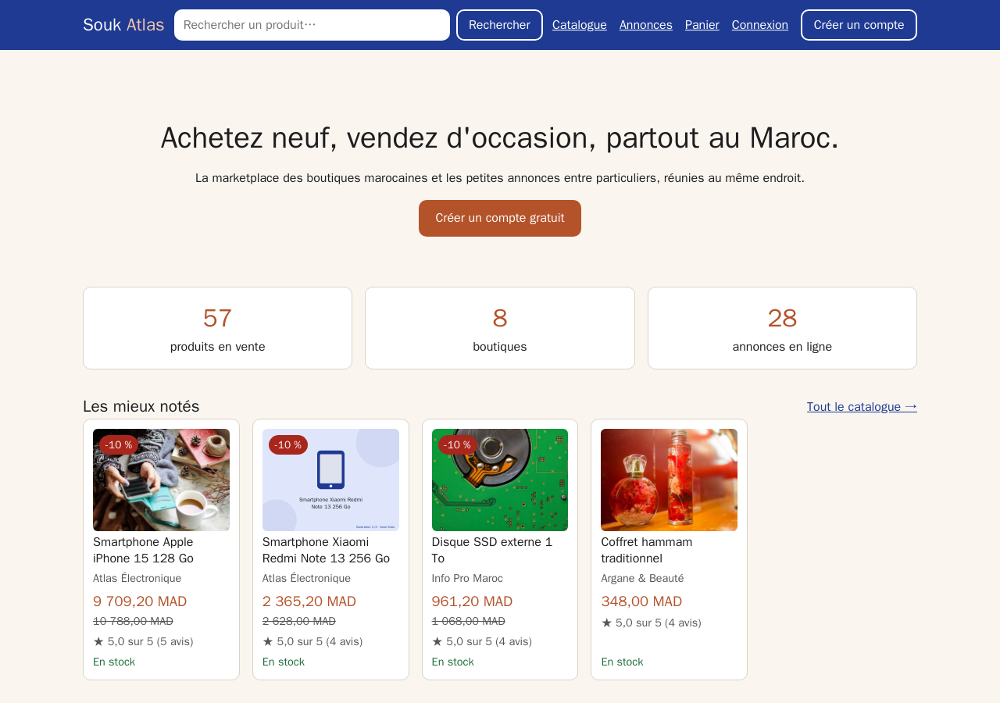
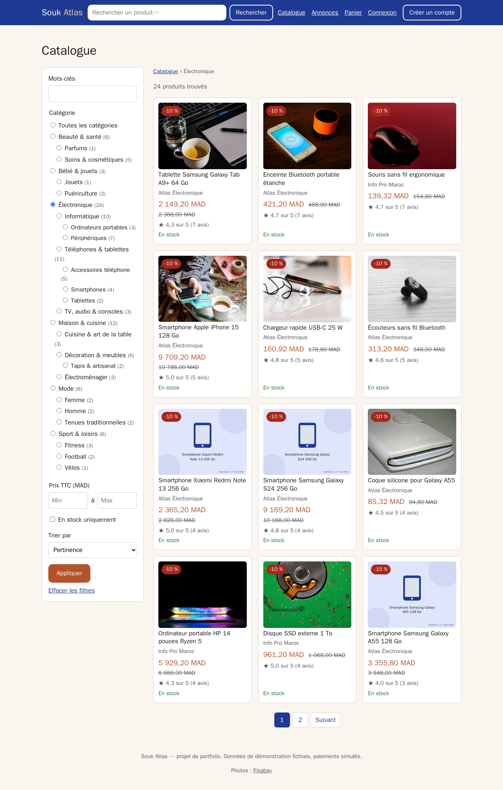
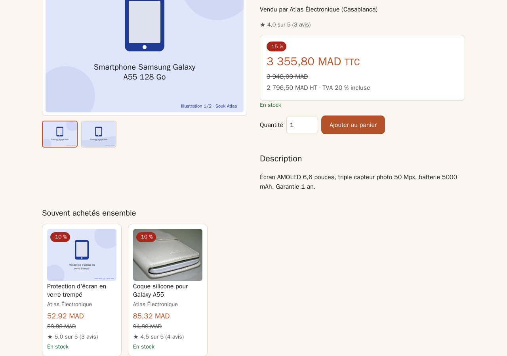
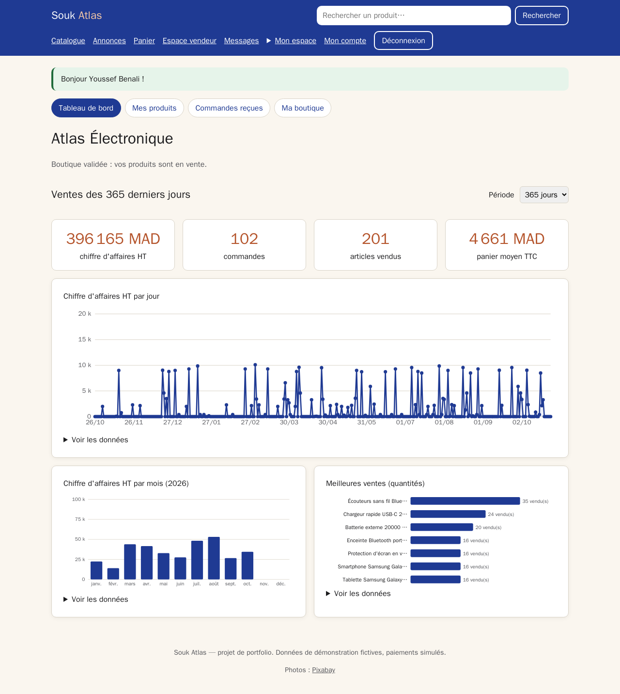
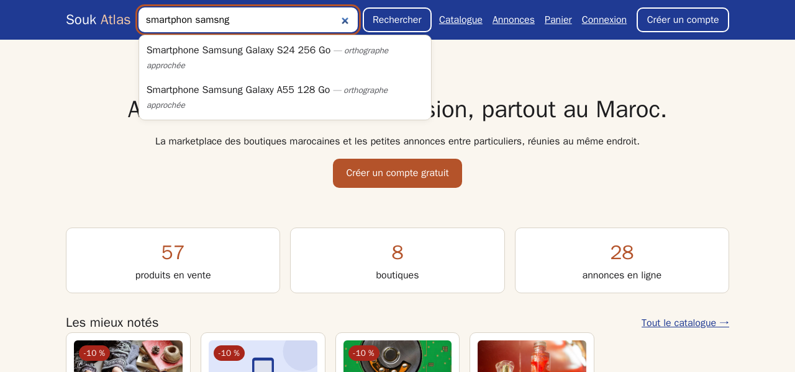
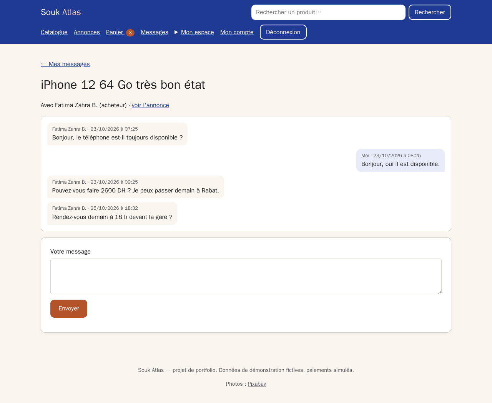
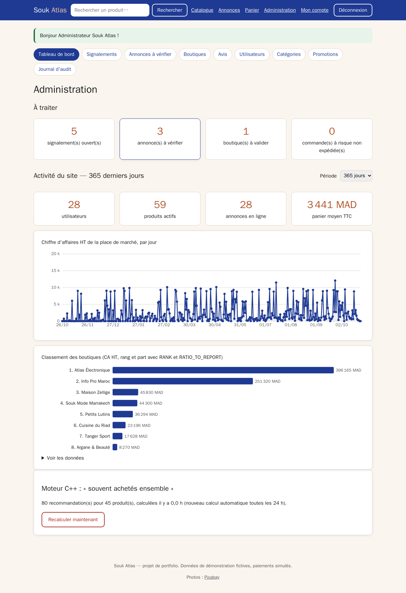

# Souk Atlas

**Site e-commerce marocain : une place de marché de boutiques professionnelles et des petites annonces entre particuliers, réunies dans une seule application.**

Projet de portfolio et de révision réalisé en 3ᵉ année à l'EMSI Rabat (Ingénierie Informatique et Réseaux).
Il fait travailler ensemble, chacun avec un **rôle réel**, les modules étudiés :
**PHP** (MVC écrit à la main), **SQL / PL/SQL** (Oracle), **JavaScript** natif et **C++** (trois programmes, dont un module WebAssembly).



> Toutes les données sont fictives et les paiements sont simulés. Le nom, les couleurs
> et les textes n'imitent aucune enseigne existante.

---

## Ce que montre le projet

| Module | Rôle dans le site | Exemples |
|---|---|---|
| **SQL / PL/SQL** (Oracle) | Toute la logique métier : 11 packages, 6 triggers, 3 jobs planifiés, 23 tables | commande en **une transaction** avec `SELECT … FOR UPDATE` ; catégories en arbre (`CONNECT BY`) ; statistiques avec `RANK`, `LAG`, `SUM … OVER` ; trigger composé ; `BULK COLLECT` / `FORALL` |
| **PHP 8.3** (sans framework) | Contrôleur frontal, routeur, MVC, sessions, sécurité, API JSON | OCI8 avec variables liées ; CSRF ; limitation des connexions ; upload sécurisé ; transactions pilotées par PHP |
| **JavaScript** (sans framework) | Pages dynamiques en modules ES | filtres sans rechargement (`history.pushState`) ; autocomplétion accessible ; panier ; graphiques SVG faits main ; messagerie |
| **C++17** — moteur | Appelé par PHP (JSON sur stdin/stdout) | recommandations « souvent achetés ensemble » (graphe) ; **score de risque** des annonces et commandes (hiérarchie de règles polymorphes) |
| **C++17** — console | Outil d'administration par l'API | import d'un catalogue CSV avec rapport d'erreurs ; modération ; rapports de ventes CSV |
| **C++17** — WebAssembly | Compilé avec Emscripten, exécuté dans le navigateur | recherche **tolérante aux fautes** (« smartphon samsng ») ; réduction des photos avant l'envoi |

Le détail (schémas, sécurité, et **où trouver chaque notion de cours dans le code**) est dans
[**docs/architecture.md**](docs/architecture.md).

---

## Fonctionnalités

**Place de marché** — catalogue avec filtres et tri sans rechargement, fiche produit avec galerie,
promotions, panier, commande (carte simulée vérifiée par l'algorithme de Luhn, ou paiement à la livraison),
facture imprimable, suivi `EN_ATTENTE → PAYEE → EXPEDIEE → LIVREE`, avis après livraison,
recommandations calculées par le moteur C++.

**Petites annonces** — publication avec photos (allégées dans le navigateur), favoris, signalements,
messagerie entre acheteur et vendeur, expiration automatique après 30 jours par un job Oracle.
Une annonce suspecte (prix anormal, « paiement par virement », compte récent…) part en **modération**.

**Espace vendeur** — boutique, produits, stock, photos, commandes reçues, tableau de bord avec graphiques.

**Administration** — modération des annonces et des avis, signalements, validation des boutiques,
utilisateurs, catégories, promotions, journal d'audit, tableau de bord global.

| | | |
|---|---|---|
|  |  |  |
| Catalogue et filtres | Recommandations du moteur C++ | Tableau de bord vendeur |
|  |  |  |
| Recherche tolérante (WebAssembly) | Messagerie | Administration |

---

## Lancer le projet

### Prérequis

- **Docker** avec **Docker Compose 2.17 ou plus récent** (Docker Desktop sous Windows ou macOS,
  ou Docker Engine sous Linux). Sous Windows, travailler dans **WSL 2** (Ubuntu) donne les meilleures performances.
- **Mémoire** : prévoir au moins **4 Go de RAM libres** pour Docker (Oracle en demande l'essentiel).
- **Disque** : environ **6 Go** (images Oracle et PHP).

Rien d'autre à installer : PHP, Oracle, le compilateur C++ et CMake tournent dans les conteneurs.

### Installation

```bash
git clone https://github.com/taha654/souk-atlas.git
cd souk-atlas
cp .env.example .env        # puis changer les mots de passe dans .env
docker compose up -d --build
```

Au **premier** lancement, comptez une dizaine de minutes : téléchargement des images,
compilation du moteur C++ (ses tests sont lancés pendant la construction), création
de la base Oracle et installation du schéma avec les données de démonstration.
Suivre l'avancement : `docker compose logs -f oracle` (le message `DATABASE IS READY TO USE!` signale la fin).
Les lancements suivants prennent quelques secondes.

Le site est alors sur **http://localhost:8000**.

> **Ports** : 8000 (site) et 1522 (Oracle), modifiables dans `.env` (`WEB_PORT`, `ORACLE_PORT`).
> **Linux** : si votre identifiant n'est pas 1000 (`id -u`), réglez `HOST_UID` et `HOST_GID` dans `.env`.

### Comptes de démonstration

Mot de passe commun : **`Demo1234!`**

| Rôle | Email |
|---|---|
| Administrateur | `admin@exemple.ma` |
| Vendeur (boutique « Atlas Électronique ») | `youssef.benali@exemple.ma` |
| Client | `amine.lahlou@exemple.ma` |

Les mots de passe sont stockés hachés (bcrypt), comme ceux des comptes créés sur le site.

### À essayer

1. Taper **« smartphon samsng »** dans la barre de recherche : le module WebAssembly retrouve le bon produit.
2. Ouvrir la fiche d'un smartphone : la rubrique **« Souvent achetés ensemble »** vient du moteur C++.
3. Se connecter en client et publier, dans « Smartphones », une annonce « iPhone 15 neuf URGENT »
   à 400 MAD avec « paiement par virement » dans la description : elle part en **modération**
   (mots suspects + prix très inférieur à la médiane de la catégorie) ; la voir ensuite en admin (`/admin/moderation`).
4. En vendeur, créer un jeton (Mon compte → Jetons d'accès), puis importer 100 produits :

   ```bash
   docker compose exec -e SOUK_JETON=souk_… php \
       souk-console import-csv /var/www/html/cpp/console/exemples/catalogue_100.csv
   ```

   Résultat : 91 produits importés, 9 lignes refusées avec la raison de chaque refus.

---

## Tests

Plus de 1 000 vérifications automatiques, toutes vertes (site démarré) :

```bash
./tests/tout_lancer.sh
```

| Suite | Contenu |
|---|---|
| C++ (CTest, 247 vérifications) | JSON, graphe, règles de risque, CSV, HTTP, console, Levenshtein, redimensionnement ; aussi sous AddressSanitizer (`./cpp/construire.sh --sanitizers`) |
| PL/SQL (300) | chaque procédure, cas normaux et cas d'erreur, avec un petit framework maison (`PKG_TEST`) |
| PHP (96) | routeur, CSRF, validations, appel du moteur C++ (absent, trop lent, réponse invalide) |
| HTTP (397) | parcours complets avec `curl` : rôles, CSRF, commandes, stock, annonces, console… |
| Navigateur (35) | Playwright : JavaScript, accessibilité clavier, WebAssembly et son repli, repli des photos |
| Compatibilité Oracle 21c | `./database/verifier_21c.sh` installe tout sur un Oracle XE 21c temporaire et relance les tests |

Les tests navigateur ne touchent pas aux captures d'écran de `docs/captures/` :
pour les refaire (après un changement visuel), ajoutez `CAPTURES=1` :

```bash
CAPTURES=1 ./tests/navigateur/lancer.sh     # ou : CAPTURES=1 ./tests/tout_lancer.sh
```

Le SQL est écrit en syntaxe **Oracle 19c / 21c** (version utilisée en cours), même si le
conteneur fait tourner Oracle 23ai Free.

---

## Organisation du dépôt

```
app/            PHP : Core (routeur, base, session, CSRF…), Controllers, Models, Services, Views
public/         seule racine web : index.php, CSS, modules JavaScript, module WebAssembly
database/       schéma, packages PL/SQL, triggers, jobs, données de démo, tests, migrations
cpp/            common/ (partagé), engine/ (moteur), console/ (outil admin), wasm/, tests/
docker/         images PHP et C++, script d'initialisation d'Oracle
tests/          tests PHP, HTTP (bash) et navigateur (Playwright)
docs/           architecture.md et captures d'écran
tools/          générateurs (photos de démo, illustrations, CSV d'exemple)
```

### Photos de démonstration

Les produits et annonces de démo utilisent des photos génériques de [Pixabay](https://pixabay.com)
(auteurs et liens sur la page `/credits`), recadrées en 800 × 600 et hébergées dans `public/images/demo/`.
Quand Pixabay n'avait pas de photo juste (sans marque ni logo), la vue garde son illustration SVG.
Pour les retélécharger, il faut une clé Pixabay dans `.env` (`PIXABAY_API_KEY`) :

```bash
docker compose exec --user "$(id -u):$(id -g)" php php tools/photos_demo.php
```

Le choix est réglable à la main dans `tools/photos_choix.json` (photo imposée, illustration imposée, photos refusées).

## Limites assumées

- Paiement **simulé** : aucun vrai numéro de carte n'est stocké (seulement les 4 derniers chiffres).
- Emails **simulés** : écrits dans `var/mails/` au format `.eml`.
- Le client HTTP de la console est écrit à la main en HTTP/1.0 : **pas de HTTPS** (il faudrait OpenSSL ou libcurl).
- Le module WebAssembly compilé (`public/assets/wasm/`) est versionné pour que le site marche sans Emscripten ;
  `./cpp/construire_wasm.sh` le régénère.
- Configuration de **développement** : pour une mise en production, il faudrait HTTPS
  (`SESSION_COOKIE_SECURE=1`), `APP_ENV=prod` et de vrais secrets dans `.env`.

---

Réalisé par **Mohamed Taha Halimi** — EMSI Rabat.
