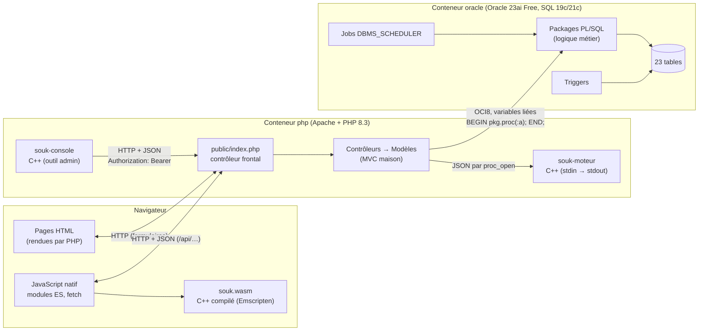
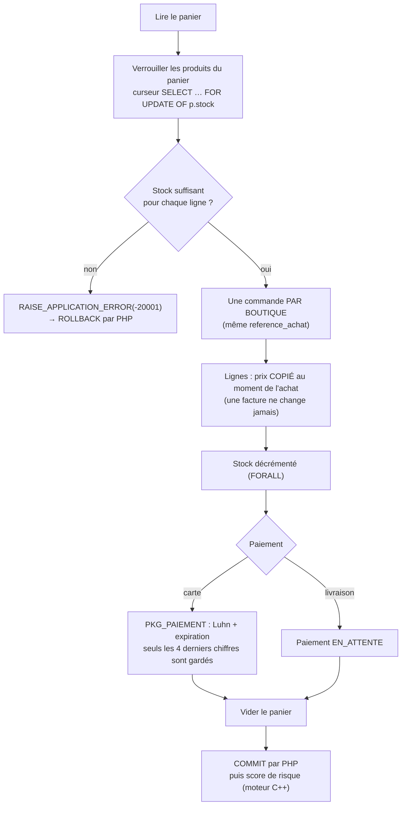
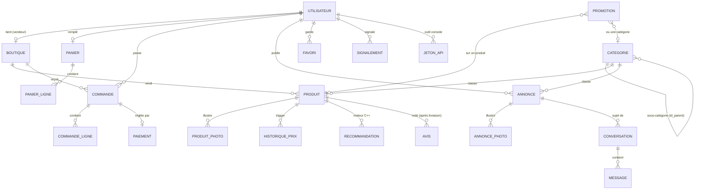
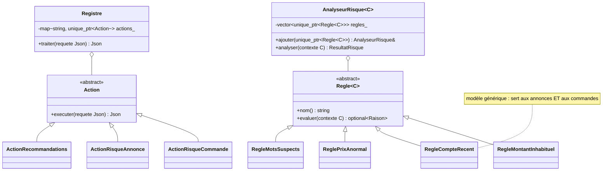
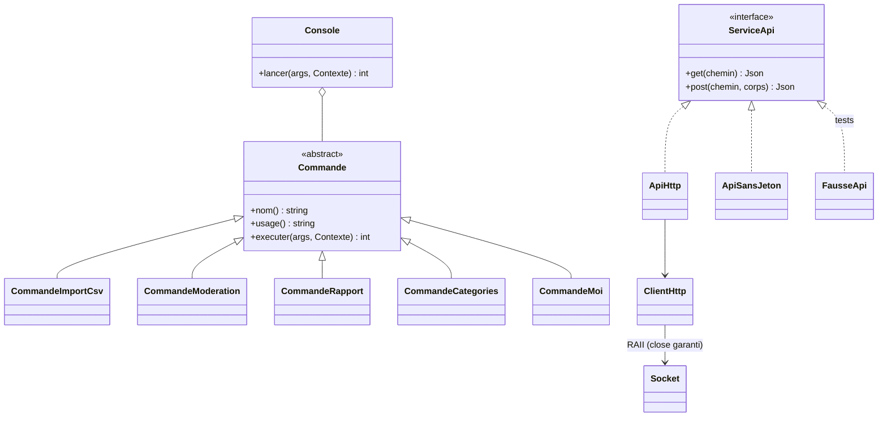
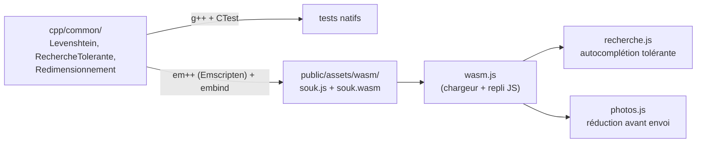

# Architecture de Souk Atlas

Ce document explique comment les morceaux du projet s'assemblent, puis indique
**où trouver chaque notion de cours** dans le code (section « Carte de révision »).
Les schémas sont écrits en [Mermaid](https://mermaid.js.org/) : GitHub les affiche directement.

---

## 1. Vue d'ensemble



| Couche | Rôle | Où |
|---|---|---|
| Oracle | Données, **règles métier** (packages), cohérence (contraintes, triggers), maintenance (jobs) | `database/` |
| PHP | HTTP, sessions, sécurité, appels aux packages, rendu HTML, API JSON | `app/`, `public/index.php` |
| JavaScript | Confort sans rechargement : filtres, autocomplétion, panier, graphiques, messagerie | `public/assets/js/` |
| C++ moteur | Calculs : recommandations (graphe), score de risque (règles) | `cpp/engine/`, `cpp/common/` |
| C++ console | Administration en ligne de commande par l'API | `cpp/console/` |
| C++ WebAssembly | Recherche tolérante aux fautes, réduction des photos dans le navigateur | `cpp/wasm/`, `cpp/common/` |

**Principe directeur** : chaque couche revérifie ce qui vient de la précédente.
Le JavaScript valide les formulaires pour le confort ; PHP revalide ; les
packages PL/SQL appliquent les règles métier ; les contraintes `CHECK`/`FK`
sont le dernier rempart. Les prix et les totaux sont **toujours** recalculés en base.

---

## 2. Le trajet d'une requête

```mermaid
sequenceDiagram
    autonumber
    participant N as Navigateur
    participant F as public/index.php
    participant C as Contrôleur
    participant M as Modèle
    participant D as Database (OCI8)
    participant O as Package PL/SQL

    N->>F: POST /commande (formulaire + _csrf)
    F->>F: Session (cookie HttpOnly, SameSite, expiration)
    F->>F: Auth::charger (compte relu en base à chaque requête)
    F->>F: Csrf::verifier (tous les POST)
    F->>F: Router : POST /commande → CommandeController@passer
    F->>C: passer()
    C->>C: Auth::exigerRole('CLIENT', 'VENDEUR')
    C->>M: Commande::passer(…)
    M->>D: appeler('BEGIN pkg_commande.passer_commande(:client, …); END;')
    D->>O: variables liées, OCI_NO_AUTO_COMMIT
    O-->>D: OK, ou RAISE_APPLICATION_ERROR(-20001, 'Stock insuffisant…')
    D-->>C: référence d'achat, ou ErreurMetier (code + message lisible)
    C->>D: valider() (COMMIT) ou annuler() (ROLLBACK)
    C-->>F: Response (redirection 303 ou page 422)
    F-->>N: en-têtes de sécurité (CSP, nosniff, DENY) + réponse
```

Points clés :

- **Une seule porte d'entrée** (`public/index.php`, `FallbackResource` d'Apache) :
  CSRF, session et erreurs sont traités une fois pour toutes.
- **PHP pilote la transaction** : les packages n'ont pas de `COMMIT` ; le contrôleur
  valide ou annule. Une erreur `-200xx` devient une `ErreurMetier` avec un message pour l'utilisateur.
- **Identité dans Oracle** : `oci_set_client_identifier` donne l'id de l'utilisateur
  du site ; les triggers d'audit le relisent avec `SYS_CONTEXT('USERENV', 'CLIENT_IDENTIFIER')`.

---

## 3. Passer une commande : une seule transaction

`PKG_COMMANDE.passer_commande` (`database/02_packages/pkg_commande.pkb`) :



Deux clients qui achètent le dernier article **au même moment** : le second attend
le verrou du premier, puis voit le stock à 0 et reçoit « Stock insuffisant ».
Un test le vérifie avec une transaction autonome (`database/tests/test_commande.sql`).

Statuts : `EN_ATTENTE → PAYEE → EXPEDIEE → LIVREE`, ou `ANNULEE` (avec remise en stock).
Les transitions autorisées sont dans `PKG_COMMANDE.transition_autorisee`.

---

## 4. Modèle de données (simplifié)



Plus `TENTATIVE_CONNEXION` (limitation des connexions) et `JOURNAL_AUDIT`
(rempli par les triggers). Toutes les contraintes sont nommées (`PK_`, `FK_`,
`CK_`, `UQ_`) et les clés étrangères sont indexées. Codes d'erreur métier :
[`database/codes_erreurs.md`](../database/codes_erreurs.md).

---

## 5. Les trois programmes C++

Code partagé dans `cpp/common/` (JSON écrit à la main avec `std::variant`,
normalisation de texte, graphe des co-achats, distance d'édition, réduction d'images).
Aucun `new`/`delete` : RAII et `std::unique_ptr` partout.

### 5.1 Moteur appelé par PHP (`souk-moteur`)



- **Protocole** : PHP (`app/Services/CppEngine.php`) lance le programme avec
  `proc_open` (commande en tableau : pas de shell, pas d'injection), écrit une
  requête JSON sur stdin, lit une ligne JSON sur stdout. Codes de sortie : 0, 2 (requête invalide), 3 (erreur interne).
  Délai de 3 s, puis `SIGKILL`. Moteur en panne → le site continue (annonce sans score).
- **Recommandations** : graphe pondéré (un sommet par produit, une arête par
  paire achetée ensemble) ; score = similarité cosinus `communs / √(a × b)`.
  Résultat rangé dans `RECOMMANDATION` en un seul appel (`oci_bind_array_by_name` + `FORALL`).
- **Score de risque** : somme des points des règles, plafonnée à 100 ; à partir
  de 60, l'annonce attend un modérateur et la commande est signalée au vendeur.

### 5.2 Outil console (`souk-console`)



- **Patron Commande** : une classe par sous-commande, rangées par nom dans `Console`.
- **Injection de dépendance** : les commandes ne connaissent que `ServiceApi` ;
  les tests utilisent une fausse API, sans serveur.
- **HTTP écrit à la main** sur sockets POSIX (HTTP/1.0). Limite assumée : pas de
  HTTPS (il faudrait OpenSSL ou libcurl).
- **Jeton** : 256 bits aléatoires, montrés une fois ; la base n'en garde que
  l'empreinte SHA-256 ; transmis par la variable `SOUK_JETON` (un argument serait visible avec `ps`).

### 5.3 Module WebAssembly



- Le **même code C++** est testé en natif puis compilé pour le navigateur.
- Pixels : le JavaScript les écrit directement dans la mémoire du module
  (`_malloc` + `HEAPU8.set`) et passe une adresse ; il libère avec `_free`.
- CSP : `'wasm-unsafe-eval'` autorise la compilation WebAssembly, `eval()` reste interdit.
- **Repli JavaScript** identique (`wasm.js`) si le `.wasm` ne se charge pas, ou avec `?moteur=js`.

---

## 6. Sécurité

| Menace | Protection | Où |
|---|---|---|
| Injection SQL | Variables liées partout, jamais de concaténation | `app/Core/Database.php` |
| XSS | `e()` (`htmlspecialchars`) dans toutes les vues ; `textContent` en JS ; CSP sans script en ligne | `app/Core/fonctions.php`, `public/index.php` |
| CSRF | Jeton par session sur **tous** les POST (champ ou en-tête `X-CSRF-Token`), vérifié dans le contrôleur frontal | `app/Core/Csrf.php` |
| Vol de session | Cookie `HttpOnly` + `SameSite=Lax` (+ `Secure` en HTTPS), `use_strict_mode`, nouvel identifiant à la connexion, expiration après inactivité | `app/Core/Session.php`, `docker/php/souk.ini` |
| Mots de passe | `password_hash` (bcrypt), 8 caractères minimum, 72 octets maximum | `app/Models/Utilisateur.php` |
| Force brute | 5 échecs / 15 min par email, 20 par adresse IP (`REMOTE_ADDR`, jamais `X-Forwarded-For`) | `app/Controllers/AuthController.php` |
| Accès non autorisé | `Auth::exigerRole()` dans chaque action ; ressource d'un autre → 404 | contrôleurs |
| Upload malveillant | Type réel (`finfo`), `getimagesize`, taille, nom aléatoire, PHP désactivé dans `uploads/` | `app/Services/Upload.php`, `docker/php/apache-souk.conf` |
| Prix falsifié | Prix et totaux recalculés en base, jamais lus dans le formulaire | `PKG_PANIER`, `PKG_COMMANDE` |
| Carte bancaire | Paiement simulé ; seuls les 4 derniers chiffres sont stockés | `PKG_PAIEMENT` |
| Injection de commande | `proc_open` avec un tableau (pas de shell) | `app/Services/CppEngine.php` |
| Jeton d'API volé en base | Seule l'empreinte SHA-256 est stockée ; révocation ; expiration | `app/Models/JetonApi.php` |
| Clickjacking, sniffing | `X-Frame-Options: DENY`, `frame-ancestors 'none'`, `nosniff` | `public/index.php` |
| Secrets | Fichier `.env` jamais versionné | `.gitignore`, `.env.example` |

---

## 7. Carte de révision : où trouver chaque notion

### SQL et PL/SQL (syntaxe compatible Oracle 19c / 21c, vérifiée sur 21c)

| Notion | Où |
|---|---|
| Contraintes nommées, `CHECK`, index sur les FK | `database/01_schema.sql` |
| Colonne virtuelle (`GENERATED ALWAYS AS … VIRTUAL`) + index | `PRODUIT.nom_recherche`, `ANNONCE.titre_recherche` |
| Arbre `CONNECT BY`, `SYS_CONNECT_BY_PATH`, `ORDER SIBLINGS BY`, `LISTAGG` | `pkg_catalogue.arbre_categories`, `chemin_categorie` |
| Tri français `NLSSORT(…, 'NLS_SORT=FRENCH')` | `pkg_catalogue.pkb` |
| Pagination `OFFSET … FETCH NEXT`, `COUNT(*) OVER ()` | `pkg_catalogue.rechercher`, `pkg_annonce.rechercher` |
| `SELECT … FOR UPDATE`, transaction métier complète | `pkg_commande.passer_commande` |
| Curseur explicite, `RECORD`, `BULK COLLECT`, `FORALL` | `pkg_commande.pkb` |
| Tableau associatif lié depuis PHP + `FORALL … INDICES OF` | `pkg_catalogue.remplacer_recommandations` |
| `SYS_REFCURSOR` lu par PHP (`oci_new_cursor`) | `app/Core/Database.php::curseur()` |
| Fonctions analytiques `RANK`, `RATIO_TO_REPORT`, `SUM … OVER`, `LAG` | `pkg_stats.pkb` |
| `MEDIAN`, `STATS_MODE`, `KEEP (DENSE_RANK FIRST …)` | `pkg_annonce.contexte_risque`, `app/Models/Moderation.php`, `pkg_catalogue.pkb` |
| `MERGE INTO` | `pkg_panier.pkb` |
| `RAISE_APPLICATION_ERROR`, exceptions nommées (`PRAGMA EXCEPTION_INIT`) | `pkg_erreurs.pks`, `database/codes_erreurs.md` |
| Trigger `BEFORE`/`AFTER` ligne, `:OLD`/`:NEW` | `trg_produit_historique_prix`, `trg_audit_*` (`03_triggers.sql`) |
| Trigger composé (contourne ORA-04091, table en mutation) | `trg_avis_note_moyenne` |
| Jobs `DBMS_SCHEDULER` | `database/04_jobs.sql` |
| Transaction autonome (test de concurrence) | `database/tests/test_commande.sql` |
| Package de tests maison | `database/tests/00_pkg_test.sql` |

### PHP

| Notion | Où |
|---|---|
| Contrôleur frontal, routeur avec paramètres `{id}` | `public/index.php`, `app/Core/Router.php` |
| MVC sans framework, autoloader écrit à la main (sans Composer) | `app/Core/`, `app/Controllers/`, `app/Models/`, `app/Views/` |
| OCI8 : connexion persistante, variables liées, transactions | `app/Core/Database.php` |
| Exceptions métier traduites depuis Oracle | `Database::traduire`, `app/Core/Erreurs/` |
| Objets immuables (`readonly`), arguments nommés, `match` | `Request`, `Response`, `FiltresCatalogue` |
| Lancer un programme externe avec délai | `app/Services/CppEngine.php` |
| API JSON, authentification par jeton | `app/Controllers/Api/` |

### JavaScript

| Notion | Où |
|---|---|
| Modules ES, `fetch`, `AbortController`, debounce | `api.js`, `recherche.js` |
| `history.pushState` / `popstate` (URL synchronisée) | `catalogue.js` |
| Motif ARIA combobox, navigation au clavier | `recherche.js` |
| Graphiques SVG construits à la main | `graphiques.js` |
| Polling, pause quand l'onglet est caché | `messagerie.js` |
| `import()` dynamique, WebAssembly, `OffscreenCanvas`, `DataTransfer` | `wasm.js`, `photos.js` |

### C++ (C++17)

| Notion | Où |
|---|---|
| `std::variant`, `std::visit`, `if constexpr` | `cpp/common/Json.cpp` |
| Analyseur à descente récursive | `cpp/common/Json.cpp` |
| Classe abstraite, destructeur virtuel, polymorphisme | `cpp/engine/Regle.hpp`, `cpp/engine/Actions.hpp` |
| Modèles de classes (`template`) | `AnalyseurRisque<C>`, `RegleCompteRecent<C>` |
| RAII, classe « move-only » | `cpp/console/Socket.hpp` |
| `std::unique_ptr`, `std::make_unique`, `std::optional` | partout |
| Patron Commande, injection de dépendance | `cpp/console/Commandes.hpp`, `Api.hpp` |
| Programmation dynamique (Levenshtein) | `cpp/common/Levenshtein.cpp` |
| Graphe (listes d'adjacence pondérées) | `cpp/common/GrapheCoAchats.cpp` |
| CMake, CTest, AddressSanitizer / UBSan | `cpp/CMakeLists.txt`, `cpp/construire.sh --sanitizers` |
| Emscripten, embind | `cpp/wasm/` |

---

## 8. Tests

| Suite | Outil | Commande |
|---|---|---|
| C++ (9 suites, 247 vérifications) | CTest + mini-cadre `Verif.hpp` | `./cpp/construire.sh` |
| PL/SQL (300) | `PKG_TEST` maison | `docker compose exec oracle /opt/souk/database/tests/lancer_tests.sh` |
| Compatibilité Oracle 21c | Oracle XE 21c temporaire | `./database/verifier_21c.sh` |
| PHP unitaires (96) | script maison | `docker compose exec php php tests/php/test_unitaires.php` |
| HTTP de bout en bout (397) | bash + curl | `./tests/http/test_*.sh` |
| Navigateur (34) | Playwright (Docker) | `./tests/navigateur/lancer.sh` |
| **Tout** | | `./tests/tout_lancer.sh` |

Les tests créent des comptes `test-…@exemple.ma` et les suppriment à la fin
(avec leurs commandes, en rendant le stock) : les données de démonstration restent intactes.
